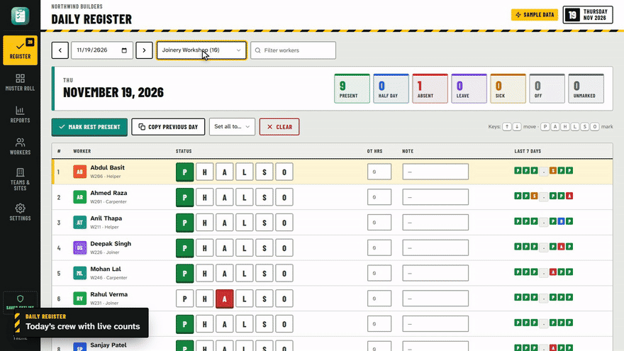
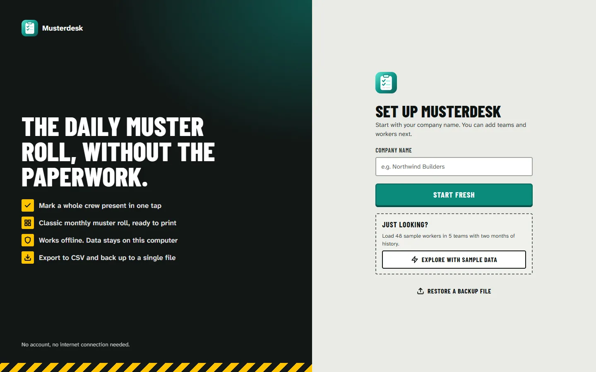
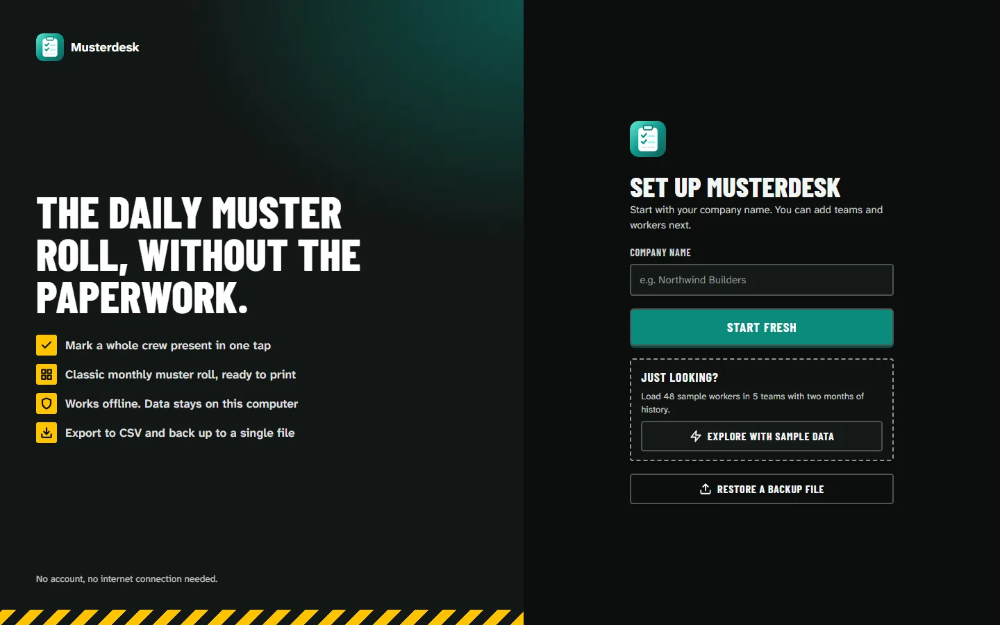
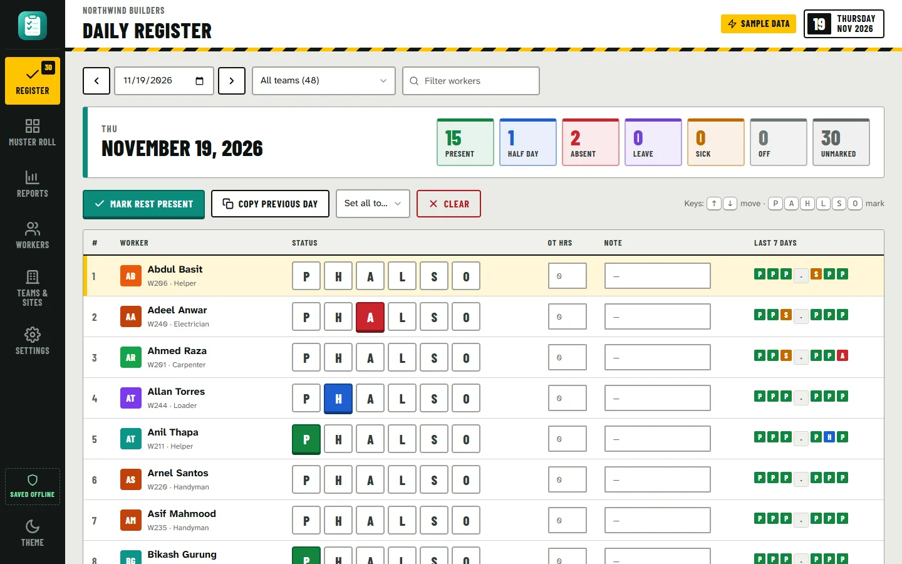
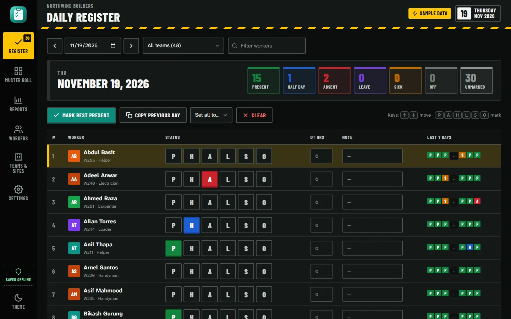
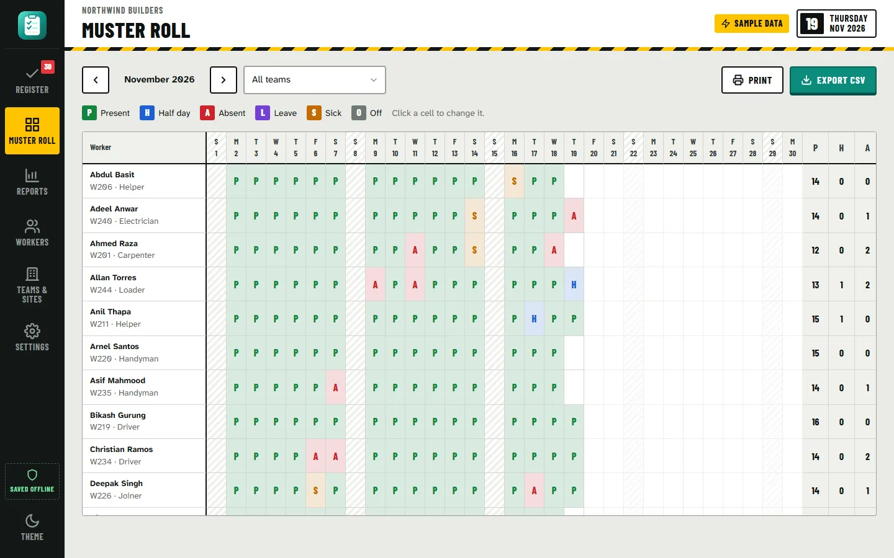
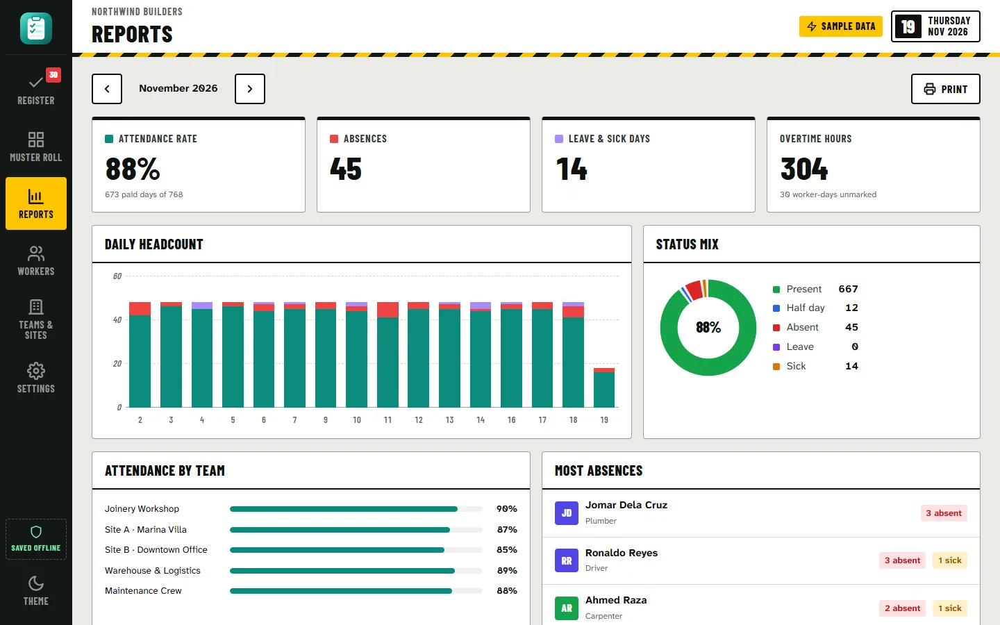
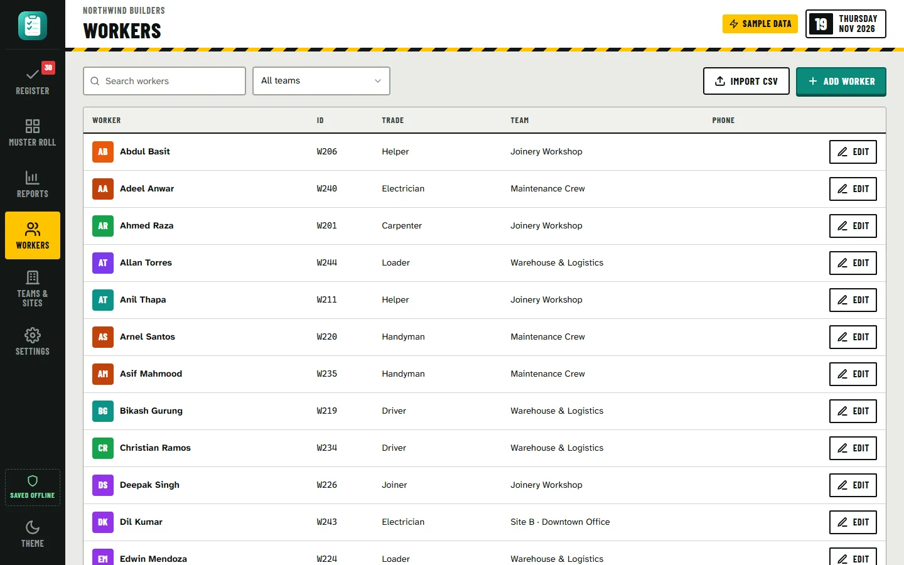
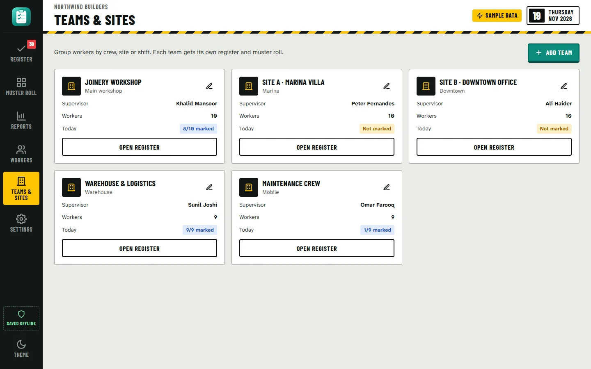
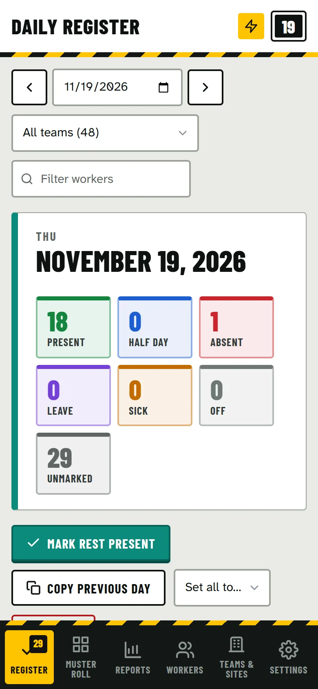

# Musterdesk

**The daily muster roll for supervisors.** Pick a date and a crew, tap **Mark rest present**, flag the few who are absent, on leave or on a half day, and lock the register. Musterdesk keeps the classic monthly muster roll for you, works fully offline, and runs in the browser or as a Windows desktop app. You don't need accounts, a server or an internet connection.

[Try it in your browser](https://musabukhari237.github.io/musterdesk/?demo) · [Download for Windows](https://github.com/MusaBukhari237/musterdesk/releases/latest) · [Report an issue](https://github.com/MusaBukhari237/musterdesk/issues)

### ▶ Watch the walkthrough (2:19)

[](https://github.com/MusaBukhari237/musterdesk/releases/download/demo-video/musterdesk-walkthrough.mp4)

*Click the preview to play the full narrated walkthrough (MP4, 1080p). It's also attached to the [demo-video release](https://github.com/MusaBukhari237/musterdesk/releases/tag/demo-video).*

## Who it's for

Site supervisors, foremen, shift leads, school and training-centre coordinators, and anyone who still takes attendance on a paper register. It suits construction and fit-out crews, factories, cleaning and security teams, farms and workshops, where workers don't carry phones or clock in themselves.

## Features

- **Daily register**: one row per worker with one-tap **P / H / A / L / S / O** buttons (present, half day, absent, leave, sick, off), plus overtime hours and a note.
- **Bulk actions**: *Mark rest present*, *Copy previous day*, *Set all to…* and *Clear*. A crew of 50 takes seconds.
- **Keyboard-first**: use ↑/↓ to move and P, A, H, L, S, O to mark, then hand the register to whoever types fastest.
- **Submit & lock**: the supervisor signs off a day. Locked days can only be changed after an explicit unlock.
- **Monthly muster roll**: a worker × day grid with totals (present, half, absent, leave, sick, overtime, paid days). Click a cell to change it. Prints landscape with signature lines.
- **Reports**: attendance rate, absences, leave and overtime, daily headcount, attendance by team, and the people with the most absences.
- **Teams and sites**: group workers by crew, site or shift, each with its own supervisor and register.
- **Holidays and weekly off days**: greyed out and excluded from working days.
- **CSV import and export**: bring in a worker list, and export the muster roll for payroll.
- **Backup and restore**: one JSON file holds everything. Move between computers in seconds.
- **Branding**: your logo and accent colour.

## Screenshots

Rugged and field-ready: high-contrast Barlow Condensed signage type, big 46 px tap targets, a hazard-striped header and an icon rail that turns into a bottom tab bar on tablets and phones.

| | |
|---|---|
| <br>**Welcome (light)** | <br>**Welcome (dark)** |
| <br>**Daily register** | <br>**Daily register in dark mode** |
| <br>**Monthly muster roll** | <br>**Reports** |
| <br>**Workers** | <br>**Teams and sites** |
| <br>**Phone and tablet layout, with a bottom tab bar** | |

## Get started

**Windows:** download `Musterdesk-x.y.z-portable.exe` from [Releases](https://github.com/MusaBukhari237/musterdesk/releases/latest) and run it. There's no installer and it doesn't need admin rights. Your data stays in your Windows profile.

**Browser:** open the [web version](https://musabukhari237.github.io/musterdesk/). Data is stored in that browser on that computer only. Download a backup from **Settings** regularly.

**From source:**

```bash
git clone https://github.com/MusaBukhari237/musterdesk.git
cd musterdesk
npm run serve        # web version on http://127.0.0.1:8080, no install needed
npm install && npm start   # desktop app (Electron)
npm run dist         # build the Windows .exe into dist/
npm test
```

## How counting works

A present day counts as 1 paid day and a half day as 0.5. Absent, leave, sick and off days count as 0. Leave is tracked separately so payroll can treat paid leave its own way. Working days exclude weekly off days and holidays. A worker-day with no mark appears as *unmarked* in reports, so missing registers are easy to spot.

## Privacy

Musterdesk never sends data anywhere. There's no telemetry, no account and no server. Everything lives in the browser's storage (or the desktop app's profile) and in the backup files you choose to download.

## White-labelling

Edit `app/brand/brand.json` (`appName`, `company`, `tagline`, `accent`, `accentInk`, `theme`, `logo`) and drop your logo next to it before building or deploying.

## Related projects

- **[Punchwell](https://github.com/MusaBukhari237/punchwell)**: employees clock themselves in and out at a kiosk or on their phone.
- **[Rostermark](https://github.com/MusaBukhari237/rostermark)**: shifts, geofencing, leave approvals and multi-site reporting.

## Sponsors

Supported by [LeadCeleris](https://www.leadceleris.com/) and [AIFFICIENTO](https://www.aifficiento.biz/).

## Contributing

Read [CONTRIBUTING.md](CONTRIBUTING.md) and [SECURITY.md](SECURITY.md). Released under the [MIT license](LICENSE).

<sub>Keywords: muster roll software, attendance register, daily attendance sheet, labour attendance app, construction crew attendance, offline attendance app, bulk attendance marking, supervisor attendance, Electron desktop app, open source.</sub>
